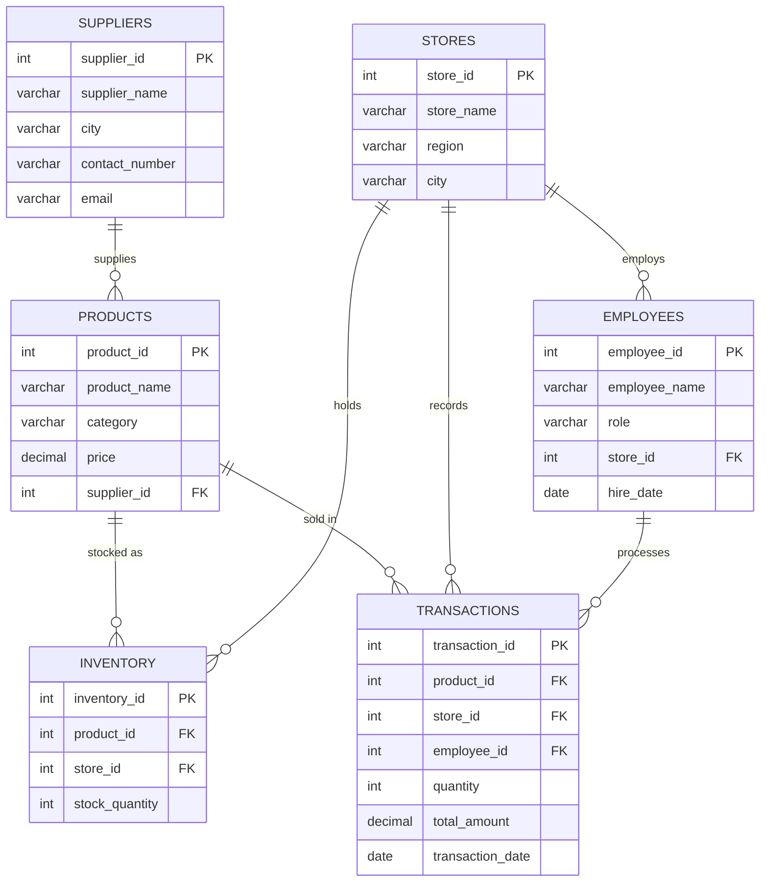

# UrbanMart Retail Operations Analysis (SQL)


A SQL case study on a 6-table retail database. I acted as a junior business analyst for UrbanMart, a retail chain with 8 stores across India. The goal was to prepare numbers for the leadership team's quarterly business review (QBR) and recommend what to fix.

**Headline:** every one of the 8 stores has at least one product out of stock. At UrbanMart Park Street, **78% of the store's revenue** came from three products that are now out of stock or below 10 units. My main recommendation is a reorder-point system, prioritised by revenue.

---

## Business Problem

The Regional Operations Head flagged two concerns before the QBR: **frequent stock-outs** and **underperforming regions**. The work moves through three stages:

| Stage | Ask from the manager | Questions | SQL used |
|---|---|---|---|
| **Fetch** | "Get me the basic numbers" | Q1–Q7 | `SELECT`, `WHERE`, `ORDER BY`, `LIMIT` |
| **Analyze** | "Help me understand what's happening" | Q8–Q15 | Multi-table `JOIN`s, `GROUP BY`, `SUM` / `AVG` / `COUNT`, `HAVING` |
| **Insights** | "What should we do about it?" | Q16–Q20 | Subqueries, conditional aggregation (`CASE`), share-of-total % |

---

## Dataset

Database `urbanmart`: **8 stores** in 4 regions, **25 products**, **8 suppliers**, **20 employees**, **60 inventory records** and **85 transactions** from **15–30 January 2024**. Total revenue is ₹1,48,335.



---

## Key Findings

1. **Stock-outs hit every store.** All 8 stores have at least one product at zero stock. 18 of 60 product-store lines (30%) are below 10 units. *(Q9, Q14, Q20)*
2. **Electronics carries the business.** It brings in 42% of revenue (₹62,962). The Smart Watch alone earned ₹24,493 from just 7 units. *(Q19b, supporting analysis)*
3. **Best-sellers by volume are not best-sellers by value.** Sugar 1kg is the top seller at 60 units, but that is only ₹3,300 of revenue. *(Q10)*
4. **Regional gaps come from basket size, not footfall.** Every region had 21–22 transactions. South leads because its average ticket is ₹1,848, against ₹1,618 in the West. *(Q12, Q17b)*
5. **The best and worst stores are both in the South region.** Koramangala is the top store at ₹27,384. T Nagar is the bottom store at ₹13,274, about half as much. The region total hides this. *(Q8, Q15)*
6. **No supplier crossed ₹50,000** (Q13 returns an empty set). The closest is TechWorld Distributors at ₹46,276. This sample covers only 16 days, so the ₹50K bar was likely meant for a full quarter. At the current pace, TechWorld would cross it within days. *(Q13, Q19)*

Full output of every query is in [`results/query_results.md`](https://github.com/imsatya16/urbanmart-sql-retail-analysis/blob/main/query_results.md).

---

## Insights & Recommendations

### Q16. Which store needs urgent replenishment?
**UrbanMart Park Street.** Three stores tie at 3 critical items each: Andheri, Park Street and T Nagar. Counting items alone can't separate them, so I measured **how much of each store's revenue came from the items now out or low** (Q16b).

| Store | Out of stock | Low stock | Revenue at risk |
|---|---|---|---|
| **Park Street** | Power Bank | Saree (5), Dinner Plate Set (6) | **₹14,391 (78%)** |
| Andheri | Mens T-Shirt | Pressure Cooker (5), Formal Shirt (8) | ₹2,798 (16%) |
| T Nagar | Smart Watch | Formal Shirt (3), Dinner Plate Set (7) | ₹2,098 (16%) |

Park Street's critical items are its own proven sellers. The store sold 3 Power Banks in this period and now has none left. At the current pace, the Saree and Dinner Plate Set will run out in about a month.

**Risk if no action is taken:** lost sales on products customers already buy there. Shoppers who find empty shelves go to competitors. The Saree is also the chain's #3 revenue product.

### Q17. Best and weakest region?
**Best: South (₹40,658). Weakest: West (₹33,984), about 16% behind.**
- **Reason:** transaction counts are almost identical (21–22 per region), so the gap is **ticket size**. In the West, 27% of revenue comes from low-priced groceries. In every other region, groceries are 9–11% of revenue.
- **The South number is misleading on its own.** Koramangala alone brings in 67% of South's revenue, while T Nagar is the weakest store in the whole chain (avg ticket ₹1,207). T Nagar is also out of the Smart Watch, the chain's highest-revenue product.
- **Action:** in the West, push higher-value categories (Electronics and Apparel placement, bundles, upselling at checkout). In the South, run a store-level review of T Nagar rather than treating the region as healthy.

### Q18. Top-performing employee?
**Karthik Raj (Koramangala): ₹18,794.** The race is close: Meera Saha has ₹18,371 and Kavita Rao has ₹18,352, so the top three are within 2.4%.
- Karthik's edge is **basket value**. He made only 6 transactions, at an average of ₹3,132, about 1.7× the next two sellers. Smart Watches account for 74% of his sales.
- Meera and Kavita win on **volume**. Each is the only salesperson at their store and made 10 transactions.
- **Recognise and retain:** give performance-linked incentives and a visible award. Karthik joined in April 2023, so a clear growth path (senior associate or floor trainer) matters early on. He could coach other stores on upselling high-value products. Recognising all three top performers together would reward both selling styles.

### Q19. Most valuable supplier?
**TechWorld Distributors: ₹46,276, or 31% of chain revenue, from just 3 products** (Smart Watch, Bluetooth Headphones, Mobile Charger).
- **Strengthen the relationship:** share weekly sales and stock data, agree on priority restocking for the Smart Watch and Headphones, and negotiate volume-based terms.
- **Watch the dependency:** nearly a third of revenue depends on one supplier. A secondary source for key electronics lines reduces that risk. The Smart Watch stock-out at T Nagar is the first item to raise with TechWorld.

### Q20. One recommendation for the QBR
**Put a reorder-point system in place, prioritised by revenue.** For example, trigger a restock alert when any product falls below 10 units, review it weekly, and start with high-revenue lines (Electronics, Sarees).

**Why this one:** stock-outs are not a one-store issue. All 8 stores have one, and 30% of product-store lines are below 10 units. The stock-outs are on proven sellers, such as Power Banks at Park Street and Smart Watches at T Nagar. Fixing availability recovers sales that customers are already trying to make. That makes it the fastest and lowest-risk revenue gain on the list.

---

## Project Structure

```
urbanmart-sql-retail-analysis/
├── data/
│   └── urbanmart_dataset.sql     # creates the database, 6 tables, sample data
├── sql/
│   ├── 01_fetch.sql              # Q1–Q7   basic retrieval
│   ├── 02_analyze.sql            # Q8–Q15  joins and aggregations
│   └── 03_insights.sql           # Q16–Q20 + supporting queries for the recommendations
├── results/
│   └── query_results.md          # output of every query
└── README.md
```

## How to Run

```bash
# 1. Create the database and load the data
mysql -u root -p < data/urbanmart_dataset.sql

# 2. Run each stage
mysql -u root -p < sql/01_fetch.sql
mysql -u root -p < sql/02_analyze.sql
mysql -u root -p < sql/03_insights.sql
```
You can also open the files in MySQL Workbench and run them in order.

## Limitations

- **16 days of data, 85 transactions.** The findings are directional, not conclusive. A full quarter would confirm the trends.
- **Inventory is a single snapshot** with no dates or reorder history, so the "run out in about a month" estimate assumes the current sales pace continues.
- **Revenue only, no cost or margin data.** "Most valuable" means highest revenue, not highest profit.
- **Two stores per region,** so one strong or weak store moves the regional total a lot.

## Skills Demonstrated

SQL (MySQL): filtering and sorting, multi-table `JOIN`s, `GROUP BY` / `HAVING`, aggregate functions, conditional aggregation with `CASE`, subqueries, share-of-total calculations. Analysis: tie-breaking with a better metric, explaining an empty result, separating volume from value, and turning query output into business recommendations.

---

**Satyabrata Sahoo**: MBA (IT & Systems Management) | Aspiring Data / Business Analyst
[LinkedIn](https://www.linkedin.com/in/imsatya16/) · [Portfolio](https://satyabratasahoo.link) · [GitHub](https://github.com/imsatya16)

*Case study and dataset from the Career 247 "Business Analytics with GenAI" program. Analysis, queries and recommendations are my own.*
